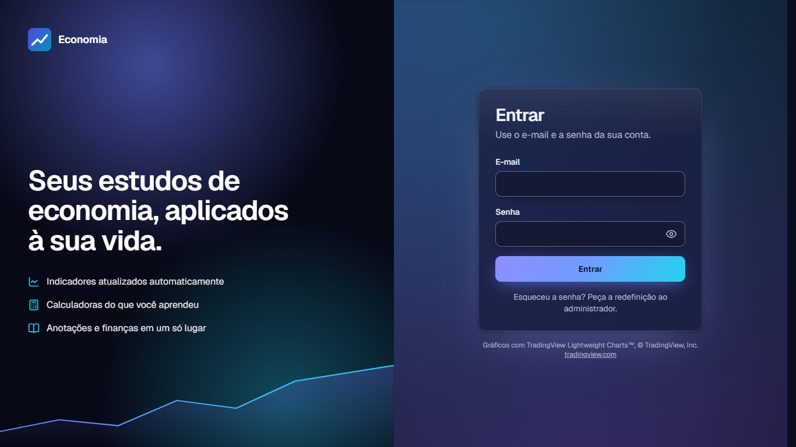
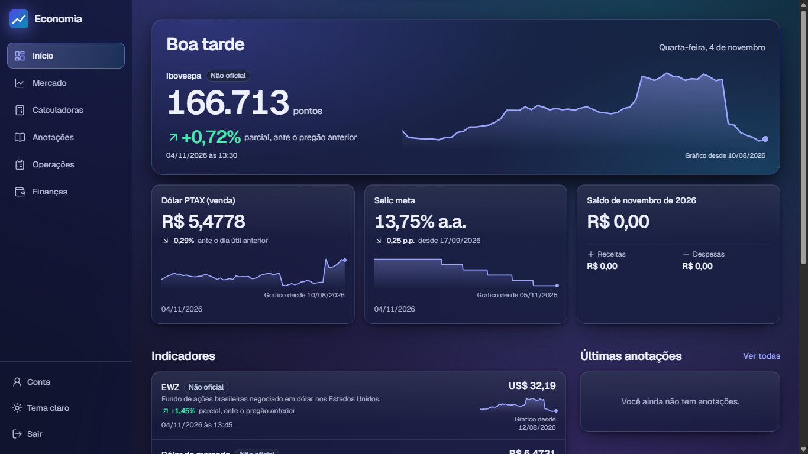
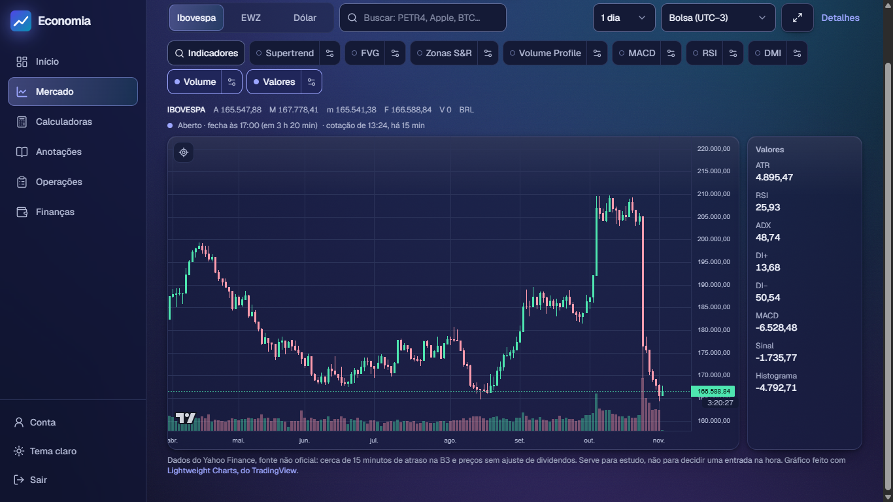
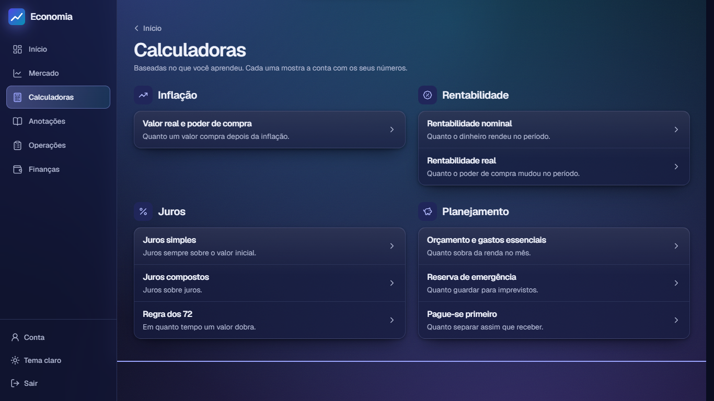
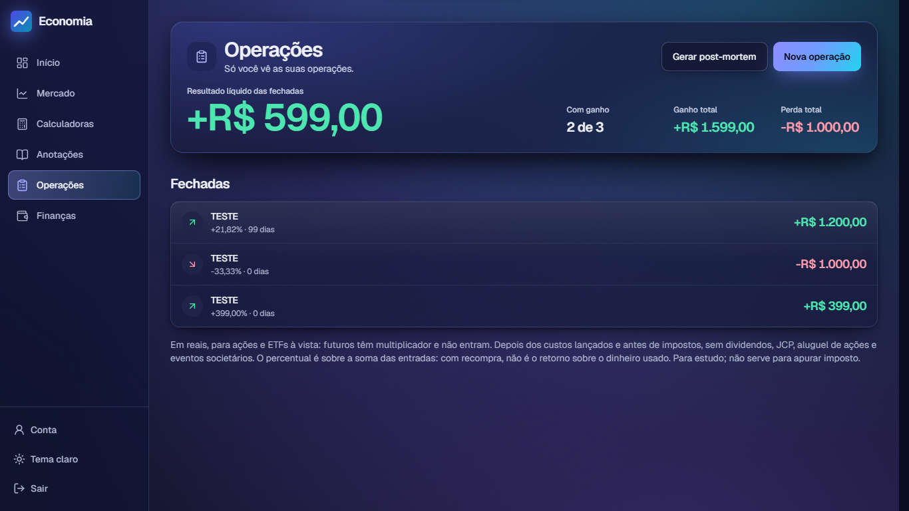
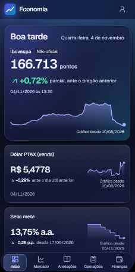
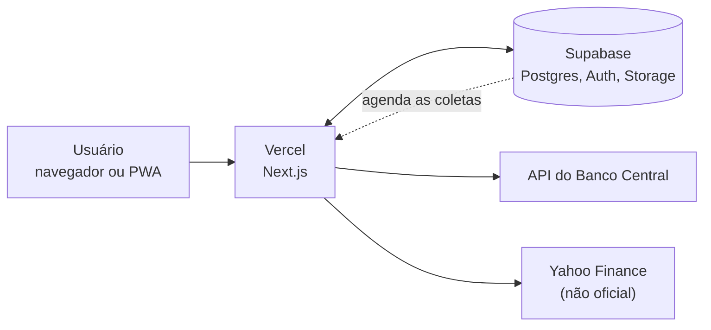

# Economia

Aplicativo web (PWA) de acompanhamento e estudo de economia, feito por mim para uso pessoal e de um colega. Cada conceito que aprendo no curso vira uma tela, um indicador ou uma calculadora.

> 🔒 **O acesso ao aplicativo e o código-fonte são privados.** Este repositório é uma apresentação do projeto. Posso mostrar o código em uma conversa ou dar acesso ao repositório a quem estiver avaliando meu trabalho: [dalmeidasdev@gmail.com](mailto:dalmeidasdev@gmail.com).

## O que ele faz

| Área | Descrição |
|---|---|
| **Início** | Principais indicadores (Selic, IPCA, dólar PTAX, Ibovespa, EWZ) com mini gráfico, histórico completo e explicação |
| **Mercado** | Gráfico de velas próprio com indicadores técnicos (RSI, MACD, DMI, ATR, Supertrend, Volume Profile e outros), vários tempos gráficos, fuso configurável e estado da sessão |
| **Calculadoras** | Nove calculadoras (inflação, rentabilidade, juros, planejamento), cada uma com a fórmula explicada |
| **Anotações** | Caderno pessoal privado e caderno de estudo compartilhado com pessoas autorizadas |
| **Operações** | Diário de operações: plano, movimentos, linha do tempo, fechamento com perguntas obrigatórias e relatório de post-mortem |
| **Finanças** | Receitas e despesas por mês, com categorias e saldo em destaque |

| Mercado | Calculadoras |
|---|---|
|  |  |

<table>
  <tr>
    <td align="center"></td>
    <td align="center"></td>
  </tr>
  <tr>
    <td align="center"><b>Operações</b></td>
    <td align="center"><b>Celular</b></td>
  </tr>
</table>

## Princípios do projeto

- **Só entra o que foi aprendido.** Nada é construído "para o futuro".
- **Toda conta tem prova.** Cada cálculo é uma função isolada, testada contra um resultado independente (por exemplo, a Calculadora do Cidadão do Banco Central). Campo vazio nunca vira zero, e entrada impossível é recusada em vez de gerar um número errado.
- **Fontes honestas.** Banco Central sempre que possível. Quando a fonte não é oficial, a tela avisa ("Não oficial") e nenhuma calculadora depende dela. O gráfico informa os limites dos dados gratuitos, como o atraso na B3.
- **Testar na tela de verdade.** Depois de publicado, cada cálculo é conferido preenchendo os campos no site, em largura de celular e de computador.

## Tecnologia

| Parte | Ferramenta |
|---|---|
| Site e servidor | Next.js, React, TypeScript |
| Visual | Tailwind CSS, Lucide |
| Gráficos | Lightweight Charts (Mercado), Recharts (indicadores) |
| Banco, login e arquivos | Supabase (Postgres), com migrações versionadas |
| Hospedagem | Vercel (região de São Paulo) |
| Testes | Vitest |

Os dados são coletados em horários agendados no banco (a cada 15 minutos no pregão para bolsa e dólar, e algumas vezes por dia útil para os dados do Banco Central) e guardados com histórico.

## Segurança e privacidade

- Login obrigatório, com verificação em duas etapas opcional
- Regras de acesso por linha (RLS) em todas as tabelas de usuário: o próprio banco recusa ler dados de outra pessoa
- Caderno compartilhado restrito a uma lista de pessoas autorizadas, alterada só pelo servidor; imagens em armazenamento privado
- Política de segurança de conteúdo (CSP) e proteção contra incorporação em outras páginas
- Limites de tamanho em textos e imagens
- Chaves de administração apenas nas tarefas do servidor, fora do código e das páginas

## Como foi feito

Desenvolvi o projeto em colaboração com o Claude (IA). Eu defino o que cada parte deve fazer, conduzo as decisões, reviso e testo o resultado.

## Status

Em evolução. Investimentos e day trading entram na ordem em que chegarem no curso.

## Contato

[dalmeidasdev@gmail.com](mailto:dalmeidasdev@gmail.com) · [github.com/dalmeidasdev](https://github.com/dalmeidasdev)

---

Gráficos com TradingView Lightweight Charts™, © TradingView, Inc. ([tradingview.com](https://www.tradingview.com)). 
© 2026 Diego Almeida. Todos os direitos reservados. As imagens mostram uma conta de teste com dados fictícios.
